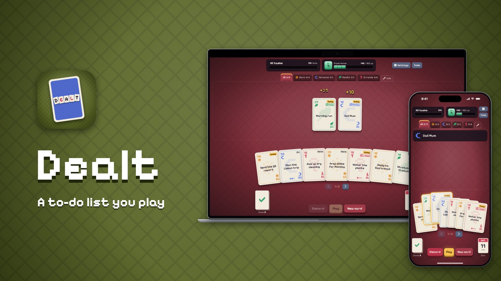

# Dealt — A to-do list you play

Dealt turns your to-do list into a card game for iPhone, iPad and Mac. Every task is a card in your hand: play it onto the table when it's done, earn XP and level up.

- **Website:** https://akdealt.github.io/dealt/
- **Support:** https://akdealt.github.io/dealt/support.html
- **Privacy policy:** https://akdealt.github.io/dealt/privacy.html

## Privacy

**Dealt does not collect any data about you.**

- Your tasks, categories, settings and progress are stored on your device, and synced between your devices through your own iCloud account. The developer can't see or access them.
- No accounts, no sign-up, no analytics, no tracking, no adverts and no third-party services.
- Dealt Pro is bought through the App Store. Apple handles the payment and only tells the app whether Pro is unlocked.
- You can delete everything at any time in the app, from Settings › Reset tasks and xp.

Read the full [privacy policy](https://USERNAME.github.io/dealt/privacy.html).

## Contact

Questions or problems? Email alexk3321@gmail.com.
